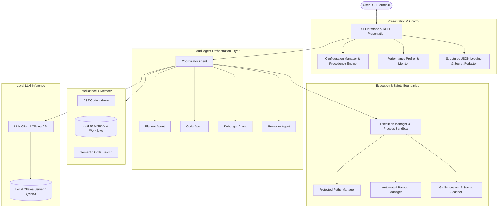

# System Architecture – Code AG

Code AG is designed as a modular, local-first autonomous AI coding system. All reasoning, code generation, terminal execution, and persistence operate on local developer hardware without cloud dependence.

---

## 1. High-Level Architecture Overview

---

## 2. Core Subsystems

### Subsystem 1: Presentation & CLI Foundation (`codeagent/cli.py`, `banner.py`)
- Built with **Typer** and **Rich**.
- Enforces UTF-8 output guards for Windows 11 console compatibility.
- Implements **lazy loading**: commands that do not require LLM inference (`version`, `config`, `monitor`, `performance`, `health`) execute immediately without loading the LLM client or network stack.
- Balanced ASCII banner rendering with dynamic status indicators.

### Subsystem 2: Configuration Precedence Engine (`codeagent/core/config_manager.py`)
- Strict 4-tier configuration precedence:
  1. CLI Arguments & Flags
  2. Environment Variables (`.env`)
  3. Global User Configuration (`~/.codeagent/config.json`)
  4. Built-in Application Defaults
- Built-in validation check across URL formats, timeout bounds, and model names.
- Automatic secret masking for safe screen dumps and diagnostics.

### Subsystem 3: Multi-Agent Orchestration (`codeagent/agents/`)
- Coordinated architecture with 5 specialized agents:
  1. **Planner Agent:** Task decomposition, dependency graphs, and execution milestones.
  2. **Code Agent:** Context-aware code synthesis and file manipulation.
  3. **Debugger Agent:** Failure diagnosis, stack trace parsing, and AST diff synthesis.
  4. **Reviewer Agent:** Security validation, style consistency, and regression checking.
  5. **Coordinator Agent:** Shared blackboard state, conflict resolution, and retry loops.
- Inter-agent communication via structured typed messages (`AgentMessage`).

### Subsystem 4: Autonomous Debugging Engine (`codeagent/debugging/`)
- Automated test discovery and execution.
- Precise error extraction and traceback localization.
- Automated hypothesis generation and unified diff patch synthesis.
- Safe rollback on patch regression.

### Subsystem 5: Project Intelligence & Memory (`codeagent/intelligence/`, `memory/`)
- AST-based multi-language code indexer (Python, TypeScript, JavaScript, Go, Rust, Java).
- SQLite-backed persistent conversation and project memory.
- Architecture mapper and project dependency analyzer.

### Subsystem 6: Git & Safety Boundary (`codeagent/safety/`, `git/`)
- Process isolation: subprocess execution strictly uses argument arrays with `shell=False`.
- Protected path manager blocks destructive writes to `.git`, `.env`, system root, and sensitive paths.
- Pre-write snapshot backups into `.codeagent/backups`.
- Secret scanner detects exposed API keys, tokens, and private keys before commit operations.

### Subsystem 7: Monitoring, Diagnostics & Profiling (`codeagent/core/`)
- Rotating JSONL logging with regex-based credential redaction.
- Sub-millisecond latency profiler for critical operational paths.
- Health inspection across runtime, database, tools, agents, disk, and Ollama.

